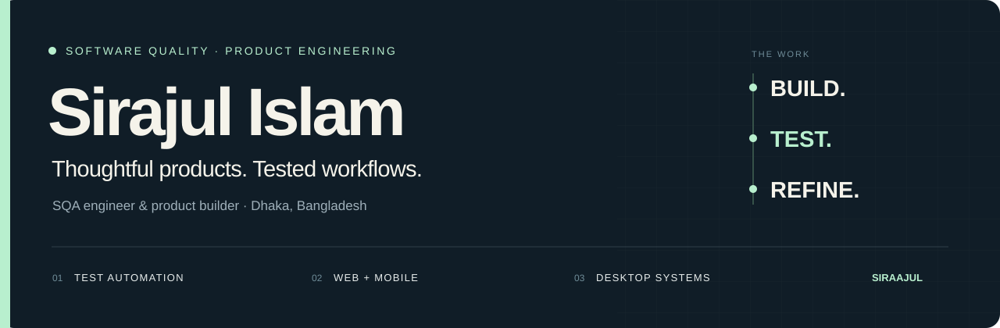
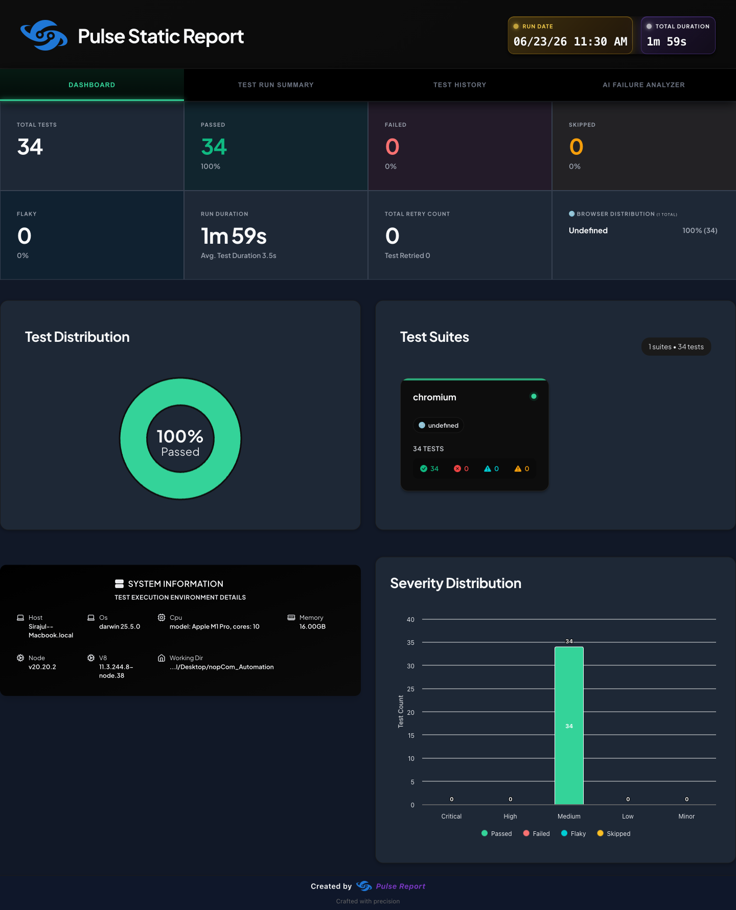
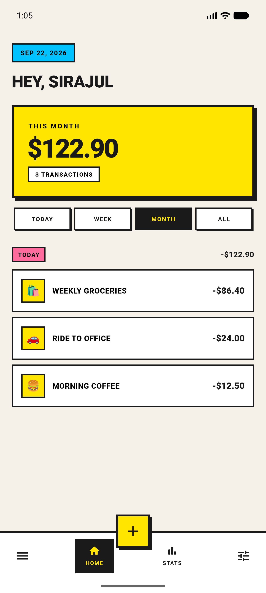
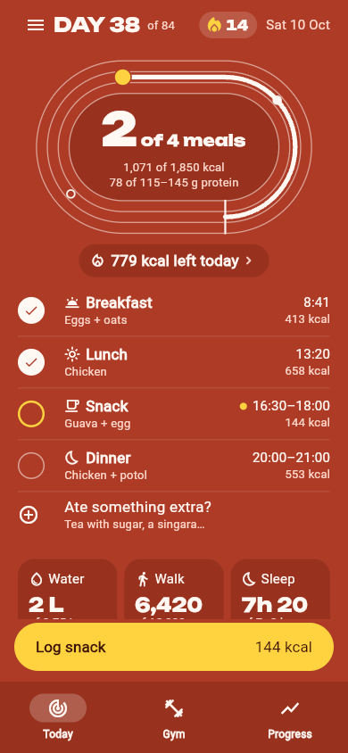

  

  <a href="https://siraajul.com"><strong>Portfolio ↗</strong></a> &nbsp;·&nbsp;
  <a href="https://www.linkedin.com/in/siraajul/">LinkedIn</a> &nbsp;·&nbsp;
  <a href="https://github.com/GeekSSort">GeekSSort</a> &nbsp;·&nbsp;
  <a href="#selected-work">Explore my work ↓</a>

I'm an **SQA engineer and product builder based in Dhaka, Bangladesh**. My work spans browser automation, API and performance testing, and web, mobile, and desktop applications.

I care about the details that decide whether software feels dependable: clear interfaces, useful error messages, correct calculations, permissions, and what happens when a connection drops. I enjoy building the product and investigating how it behaves under real use.

## Selected work

A selection of public projects across quality engineering and product development. The repositories include their setup, scope, and supporting material.

<table>
  <tr>
    <th width="50%" align="left">Quality engineering</th>
    <th width="50%" align="left">Product building</th>
  </tr>
  <tr>
    <td valign="top">
      <h3><a href="https://github.com/siraajul/nopCom_Automation">nopCommerce Automation ↗</a></h3>
      
Browser tests for registration, login, product search, carts, and checkout. Page objects, reusable fixtures, and screenshots, traces, and video for investigating failures.

      
<code>Playwright</code> <code>TypeScript</code> <code>E2E</code>

    </td>
    <td valign="top">
      <h3><a href="https://github.com/siraajul/ledger">Ledger ↗</a></h3>
      
An expense tracker with a distinct visual identity, BLoC state management, Firebase sync, and offline support. Built around quick entry and a clear view of spending.

      
<code>Flutter</code> <code>Dart</code> <code>Firebase</code>

    </td>
  </tr>
  <tr>
    <td valign="top">
      <h3><a href="https://github.com/siraajul/testfolio">Testfolio ↗</a></h3>
      
A manual QA portfolio covering test planning, boundary analysis, case design, execution records, and structured bug reports.

      
<code>Test design</code> <code>BVA / EP</code> <code>Manual QA</code>

    </td>
    <td valign="top">
      <h3><a href="https://github.com/siraajul/daur">Daur · দৌড় ↗</a></h3>
      
A fitness and meal-planning app built around Bangladeshi routines: local foods, daily tracking, training, and a focused onboarding journey.

      
<code>Flutter</code> <code>Firebase</code> <code>Product UX</code>

    </td>
  </tr>
  <tr>
    <td valign="top">
      <h3><a href="https://github.com/siraajul/K6Mastery">k6 Mastery ↗</a></h3>
      
API performance tests with authenticated flows, staged load, endpoint-specific thresholds, validation checks, and HTML reports.

      
<code>k6</code> <code>JavaScript</code> <code>API testing</code>

    </td>
    <td valign="top">
      <h3><a href="https://github.com/siraajul/jobab">Jobab · জবাব ↗</a></h3>
      
An AI sales-agent prototype and merchant inbox for Bangladeshi social commerce, with Bangla, Banglish, and English conversations.

      
<code>Next.js</code> <code>NestJS</code> <code>PostgreSQL</code>

    </td>
  </tr>
  <tr>
    <td valign="top">
      <h3><a href="https://github.com/siraajul/testkart">TestKart ↗</a></h3>
      
A BDD automation framework for e-commerce search, pagination, and data extraction, using Cucumber scenarios and a Page Object Model.

      
<code>Playwright</code> <code>Cucumber</code> <code>JavaScript</code>

    </td>
    <td valign="top">
      <h3><a href="https://github.com/siraajul/MeFolio">MeFolio ↗</a></h3>
      
The source behind my personal portfolio: a Next.js site with Sanity-managed content, responsive layouts, and motion.

      
<code>Next.js</code> <code>TypeScript</code> <code>Sanity</code>

    </td>
  </tr>
</table>

**Also worth a look:** [Postman API testing](https://github.com/siraajul/TheCatAPI) · [Jest unit tests](https://github.com/siraajul/jestwise) · [Testing scenarios](https://github.com/siraajul/scenario-log) · [My macOS toolkit](https://github.com/siraajul/toolkit)

## A glimpse of the work

<table>
  <tr>
    <td width="50%" align="center" valign="top">
      
      
<strong>Automation with evidence</strong> A documented Playwright run and its report. Historical results and setup are in the project.

    </td>
    <td width="25%" align="center" valign="top">
      
      
<strong>Ledger</strong> Expense-tracker app screenshot.

    </td>
    <td width="25%" align="center" valign="top">
      
      
<strong>Daur</strong> Daily tracking design preview.

    </td>
  </tr>
</table>

## How I approach the work

- **Start with the journey.** Understand what the person is trying to finish before choosing a tool or designing a test.
- **Investigate failures.** Reproduce the problem, trace the state and data, and keep evidence that explains the cause.
- **Keep automation readable.** Use clear scenarios, reusable fixtures, and reports that help someone debug the next failure.
- **Review the actual experience.** Check keyboard use, navigation, viewport behavior, empty states, and recovery paths in the app.

## What I work with

| Area | Tools and technologies |
| --- | --- |
| **Quality engineering** | Playwright · Cypress · Selenium · Postman · k6 · Jest · Cucumber |
| **Web and backend** | TypeScript · JavaScript · React · Next.js · Astro · Node.js · NestJS |
| **Mobile and desktop** | Flutter · Dart · SwiftUI · Electron |
| **Data and delivery** | PostgreSQL · SQLite · Firebase · Docker · GitHub Actions |

## On my desk

- Desktop POS and back-office workflows, with attention to offline behavior, printing, keyboard checkout, and onboarding.
- Product UX that helps people finish everyday tasks quickly.
- Sharpening my system-design and testing judgment through practical projects and failure analysis.

## Let's connect

I'm happy to talk about **software quality, test automation, product UX, and building useful apps**.

**[siraajul.com](https://siraajul.com)** &nbsp;·&nbsp; **[LinkedIn](https://www.linkedin.com/in/siraajul/)** &nbsp;·&nbsp; **[GeekSSort](https://github.com/GeekSSort)**

Elsewhere & support

 

[Daily.dev](https://app.daily.dev/siraajul) · [WakaTime](https://wakatime.com/@e1175194-8cfe-478b-bb21-f1b614745b66) · [Buy me a coffee](https://www.buymeacoffee.com/sirajul) · [Ko-fi](https://ko-fi.com/sirajul)

---

From Dhaka, Bangladesh · Building, testing, and learning in public.

